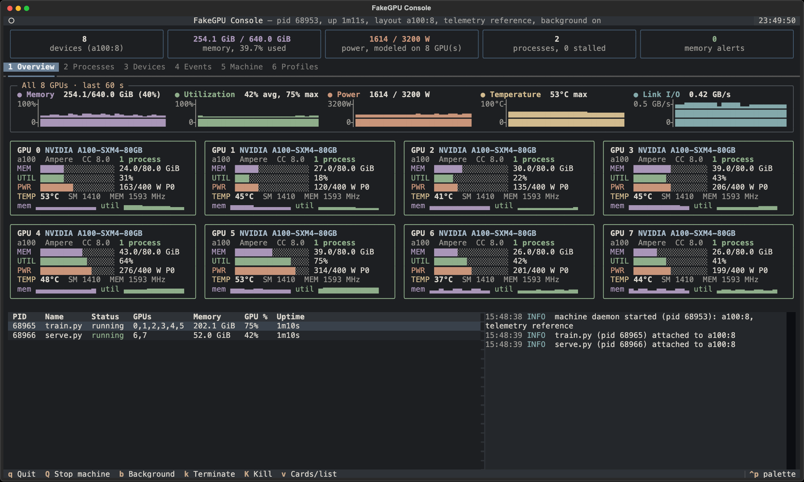
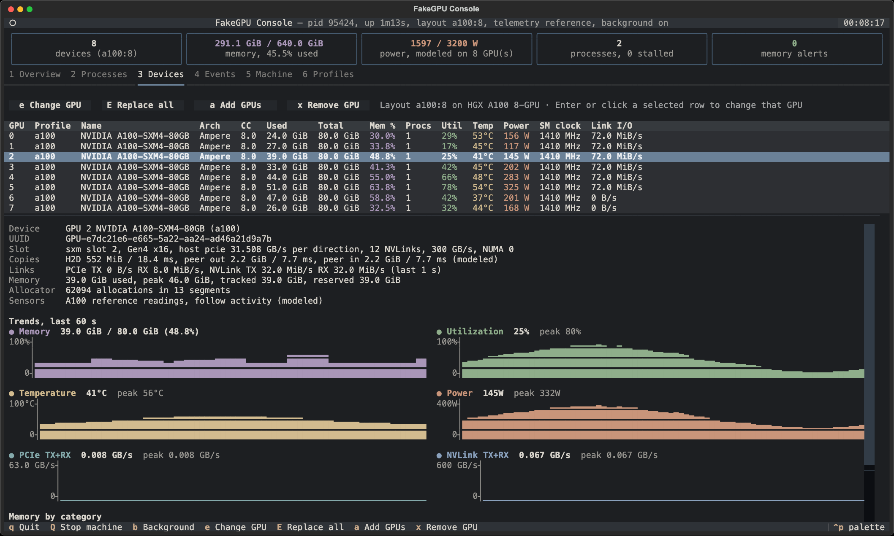
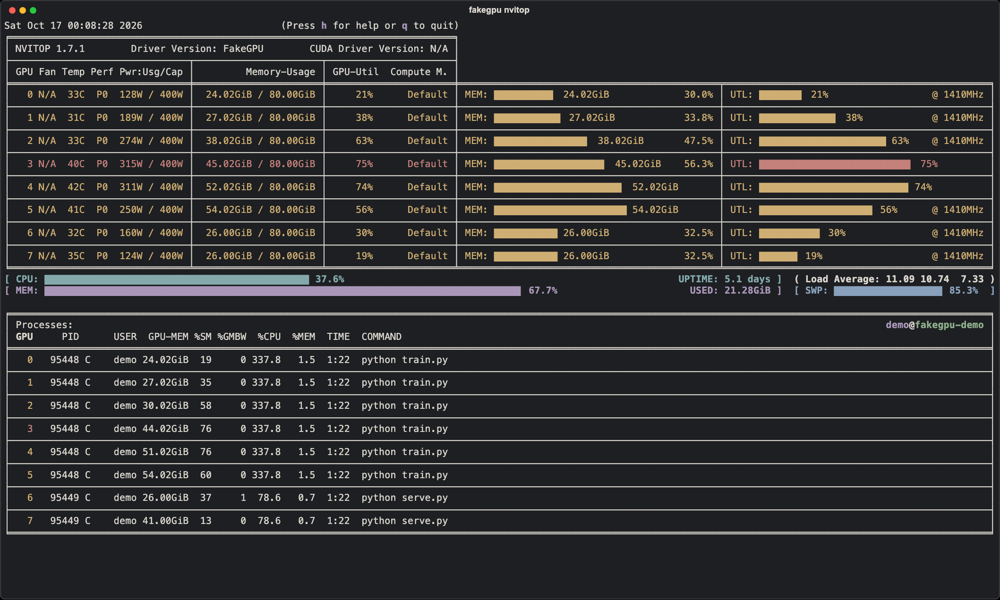

<a id="readme-top"></a>

<div align="center">

# FakeGPU

**无需生产级 GPU 集群，即可验证面向 CUDA 的应用、估算 GPU 显存并模拟分布式 GPU 工作流。**

[![测试][test-shield]][test-url]
[![版本][release-shield]][release-url]
[![Python][python-shield]][python-url]
[![许可证][license-shield]][license-url]

[English](README.md) · [简体中文](README.zh-CN.md) · [繁體中文](README.zh-TW.md)

[报告问题](https://github.com/FanBB2333/FakeGPU/issues/new?labels=bug) ·
[提出功能建议](https://github.com/FanBB2333/FakeGPU/issues/new?labels=enhancement)

</div>

> [!IMPORTANT]
> FakeGPU 用于开发、兼容性测试和容量规划。它不能让任意 CUDA kernel 获得与真实
> GPU 相同的数值结果或性能。Passthrough、hybrid 和校准流程仍需要真实的 CUDA
> 环境。

## 目录

1. [项目介绍](#项目介绍)
2. [快速开始](#快速开始)
3. [使用方式](#使用方式)
4. [文档](#文档)
5. [开发](#开发)
6. [限制](#限制)
7. [参与贡献](#参与贡献)
8. [许可证](#许可证)
9. [致谢](#致谢)

## 项目介绍

FakeGPU 让没有 GPU 的机器看起来像有 GPU 一样。应用能看到可配置的 NVIDIA 风格设备，
支持的运算实际在 CPU 上执行。FakeGPU 同时会记录显存和通信情况。这样在花钱租用
真实硬件之前，你就能确认代码能不能跑通、工作负载放不放得下。

它有三种工作方式：

- **Python FakeCUDA**：PyTorch 代码可以使用 `cuda` 设备，tensor 实际留在 CPU 上。
- **原生库拦截**：替代 `libcuda`、`libcudart`、`libcublas`、`libnvidia-ml` 和
  `libnccl` 加载，未修改的程序也能运行。
- **静态估算器**：读取模型元数据和配置，报告显存、FLOP 和通信量，不加载权重。

只有 passthrough、hybrid 和校准流程需要物理 GPU。

<a id="use-cases"></a>

### 能做什么

- **租 GPU 之前先选型。** 用 `estimate-llm` 估算 checkpoint、KV cache、activation
  和 optimizer 显存，或用 `preflight` 把工作负载跑到指定阶段。
- **规划 LLM 服务容量。** `plan-serving` 检查显存能容纳多少 chat、RAG 或
  speculative decoding 请求，也支持 vLLM 风格的预算。
- **在笔记本或纯 CPU 的 CI 中开发 CUDA 代码。** 在脚本中调用
  `fakegpu.init(...)`，或者试试 `demo` 和 `validate`。
- **比较训练方案。** `plan-training` 估算全量微调、LoRA、QLoRA、分片和 offload 的
  单 rank 显存。
- **规划 diffusion 生成。** `estimate-diffusion` 展示分辨率、batch size、CFG、
  VAE tiling 和 offload 对显存的影响。
- **审查陌生的 GPU 仓库。** `analyze-repo`、`analyze-kernel` 和 `capabilities`
  列出 GPU 入口、kernel 和不支持的 API。
- **排查分布式工作流。** `simulate-topology`、`replay-trace` 和 `bandwidth` 覆盖
  collective 路由、rank 等待和 payload 检查。
- **观察模拟设备。** `nvidia-smi` 和 `metrics` 显示设备和进程，并导出 Prometheus
  指标。
- **用真实 GPU 检验估算。** `calibrate` 将预测值与实测峰值对比，并执行误差门槛。

在已记录的验证工作负载上，校准后的显存估算器在 26 个受控 GPU 观测中误差不超过
0.08%，在十个 Qwen SFT 用例中不超过 1.921%。这些结果只针对固定工作负载。完整证据
见[验证与可靠性](docs/zh-CN/validation.md)。

### 主要技术

- [Python](https://www.python.org/) 3.10+：runtime、估算器和 CLI
- C++17 与 [CMake](https://cmake.org/)：原生库
- [PyTorch](https://pytorch.org/)：基于 CPU 的 FakeCUDA 执行

<p align="right">(<a href="#readme-top">返回顶部</a>)</p>

## 快速开始

需要 Linux 或 macOS、Python 3.10+、CMake 3.14+、支持 C++17 的编译器，Python
runtime 还需要 PyTorch。Debian 或 Ubuntu 请安装 `build-essential`，macOS 请安装
Xcode Command Line Tools。

```bash
git clone https://github.com/FanBB2333/FakeGPU.git
cd FakeGPU
scripts/build.sh
FAKEGPU_BUILD_DIR="$PWD/build" python3 -m pip install '.[torch]'
```

检查安装是否正常：

```bash
python3 -m fakegpu doctor --list-profiles
python3 -m fakegpu demo --profile l4
```

`doctor` 检查 profile 目录、原生库和 PyTorch。`demo` 在 CPU 上执行一个小型训练
步骤，同时让程序看到 CUDA 设备。

原生 macOS Conda 环境的安装方法见
[macOS 环境说明](docs/zh-CN/development.md#macos-conda-环境)。

<p align="right">(<a href="#readme-top">返回顶部</a>)</p>

## 使用方式

### 用 FakeCUDA 运行 PyTorch 代码

请在导入 PyTorch 之前初始化 FakeGPU：

```python
import fakegpu

fakegpu.init(runtime="fakecuda", profile="a100", device_count=2)

import torch

device = torch.device("cuda:0")
model = torch.nn.Linear(8, 4).to(device)
loss = model(torch.randn(2, 8, device=device)).square().mean()
loss.backward()

print(torch.cuda.device_count())      # 2
print(torch.cuda.get_device_name(0))  # NVIDIA A100
```

### 运行未修改的程序

启动器会自动设置 `LD_PRELOAD` 或 `DYLD_INSERT_LIBRARIES`：

```bash
python3 -m fakegpu --build-dir build --devices "a100:2,h100:2" \
  python3 your_script.py
```

更多选项见[原生库拦截](docs/zh-CN/native-interception.md)。

### 运行前检查显存

```bash
# 把 train.py 执行到 forward 阶段，报告能否放下。
python3 -m fakegpu preflight --runtime fakecuda --profile a100 \
  --stage forward --report-dir build/preflight -- python3 train.py

# 只读取 safetensors header，估算 LLM 推理显存。
python3 -m fakegpu estimate-llm --model-dir /models/example \
  --prompt-tokens 128 --generated-tokens 32 --target-profile a100

# 规划在线 serving 请求池。
python3 -m fakegpu plan-serving --model-dir /models/example \
  --active-sequences 16 --prompt-tokens 4096 --generated-tokens 256 \
  --target-profile a100
```

### 查看模拟设备

```bash
export FAKEGPU_SMI_STATE_DIR=build/smi
python3 your_script.py &
python3 -m fakegpu nvidia-smi --state-dir build/smi
```

macOS/Linux 上可用 `fakegpu nvitop --state-dir build/smi` 查看状态，安装与双终端示例见 [NVML 桥接说明](docs/zh-CN/fakegpu-smi.md#在-macos-或-linux-上使用-pip-安装的-nvitop)。

如果想让一台模拟机器在后台持续运行，安装 `console` 扩展后执行 `fakegpu console`：
FakeCUDA 进程会接入这台机器，控制台用曲线展示每张 GPU 的显存、利用率、功耗和温度，
还可以在 Devices 标签页逐张更换 GPU 型号。`fakegpu nvitop` 和 `fakegpu nvidia-smi`
读取的是同一台机器，详见[控制台说明](docs/zh-CN/console.md)。

<p align="center">
  
</p>
<p align="center">
  
  
</p>
<p align="center"><sub>8 张模拟 A100 运行两个演示负载：控制台的 Overview 与 Devices 标签页，以及
<code>fakegpu nvitop</code> 中的同一台机器。所有读数均为模型数值，不是硬件测量。</sub></p>

运行 `python3 -m fakegpu --help` 查看所有命令，运行
`python3 -m fakegpu <command> --help` 查看某个命令的选项。

<p align="right">(<a href="#readme-top">返回顶部</a>)</p>

## 文档

详细指南在 [`docs/`](docs/zh-CN/README.md) 中：

- [命令参考](docs/zh-CN/commands.md)
- [显存分析与估算](docs/zh-CN/estimation.md)：
  `preflight`、`analyze-repo`、`estimate-llm`、`estimate-diffusion`
- [在线 LLM serving](docs/zh-CN/serving.md)：`plan-serving`、vLLM 预算、
  speculative decoding、混合请求、`benchmark-serving`
- [微调时间与显存](docs/zh-CN/finetuning.md)
- [Diffusion 训练](docs/zh-CN/diffusion-training.md)
- [分布式规划与实验批量运行](docs/zh-CN/distributed.md)
- [FakeGPU-SMI 与监控](docs/zh-CN/fakegpu-smi.md)
- [平台与插槽](docs/zh-CN/platforms.md)：基板、超级芯片、PCIe 插槽、NVLink 桥
- [原生库拦截](docs/zh-CN/native-interception.md)
- [框架兼容性](docs/zh-CN/frameworks.md)：TensorFlow、scikit-learn 与 CUDA C/C++
- [对照真实 GPU 校准](docs/zh-CN/calibration.md)
- [验证与可靠性](docs/zh-CN/validation.md)
- [开发与测试](docs/zh-CN/development.md)
- [限制](docs/zh-CN/limitations.md)

GPU profile 是 [`profiles/`](profiles/) 中的 YAML 文件。目录收录了从 Maxwell 到
Blackwell 的 307 个可选配置，涵盖桌面、笔记本、不同显存与板卡版本。
型号、参数和来源见[完整目录](profiles/README.md)。用 `--profile` 或 `FAKEGPU_PROFILE` 选择一个，或用
`--devices` 传入混合列表。面向物理设备的示例使用 `TARGET_GPU_PROFILE`，请把它设为
`python3 -m fakegpu doctor --list-profiles` 列出的某个目录 ID。

<p align="right">(<a href="#readme-top">返回顶部</a>)</p>

## 开发

```bash
scripts/build.sh          # 构建原生库
scripts/test.sh python    # Python 测试
scripts/test.sh all       # 所有维护中的测试
```

构建选项、测试组和项目结构见[开发与测试](docs/zh-CN/development.md)。

<p align="right">(<a href="#readme-top">返回顶部</a>)</p>

## 限制

- 原生模拟不能执行任意 CUDA kernel，FakeCUDA 也不支持二进制 CUDA 扩展。
- 显存估算可能遗漏 backend 私有分配、自定义 operator 和 allocator 行为。依赖这些
  估算之前，请先在真实硬件上校准。
- 模拟器给出的耗时不是 NCCL、NVLink 或 kernel benchmark。
- Hybrid 和 passthrough 模式需要可用的 CUDA 环境。

完整列表见[限制](docs/zh-CN/limitations.md)。计划中的工作记录在
[open issues](https://github.com/FanBB2333/FakeGPU/issues) 中。

<p align="right">(<a href="#readme-top">返回顶部</a>)</p>

## 参与贡献

欢迎提交问题报告、测试用例、profile 修正、文档改进和代码修改。

1. Fork 仓库并创建分支。
2. 为修改的行为添加或更新测试。
3. 执行 `scripts/test.sh all`。
4. 使用 [Conventional Commit](https://www.conventionalcommits.org/) 格式的信息
   提交，然后创建 pull request。

报告显存估算或兼容性问题时，请附上完整命令、profile、软件版本和生成的报告。

<p align="right">(<a href="#readme-top">返回顶部</a>)</p>

## 许可证

项目采用 MIT License，详情见 [LICENSE](LICENSE)。

<p align="right">(<a href="#readme-top">返回顶部</a>)</p>

## 致谢

- README 结构参考
  [Best-README-Template](https://github.com/othneildrew/Best-README-Template)
- 基于 [PyTorch](https://pytorch.org/) 验证 CPU 框架行为
- 使用 [CMake](https://cmake.org/) 构建原生库

<p align="right">(<a href="#readme-top">返回顶部</a>)</p>

[test-shield]: https://img.shields.io/github/actions/workflow/status/FanBB2333/FakeGPU/test.yml?branch=main&style=for-the-badge&label=tests
[test-url]: https://github.com/FanBB2333/FakeGPU/actions/workflows/test.yml
[release-shield]: https://img.shields.io/github/v/release/FanBB2333/FakeGPU?include_prereleases&sort=semver&style=for-the-badge
[release-url]: https://github.com/FanBB2333/FakeGPU/releases
[python-shield]: https://img.shields.io/badge/Python-3.10%2B-3776AB?style=for-the-badge&logo=python&logoColor=white
[python-url]: https://www.python.org/
[license-shield]: https://img.shields.io/github/license/FanBB2333/FakeGPU?style=for-the-badge
[license-url]: LICENSE
